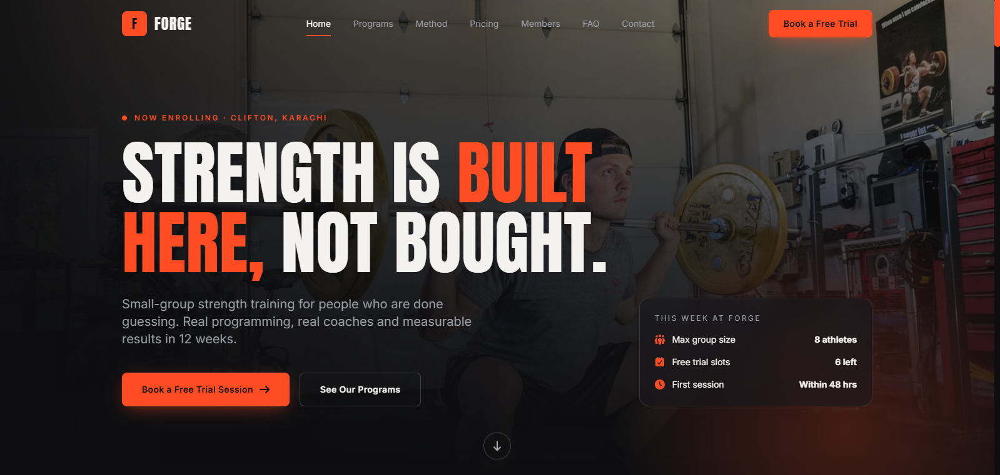
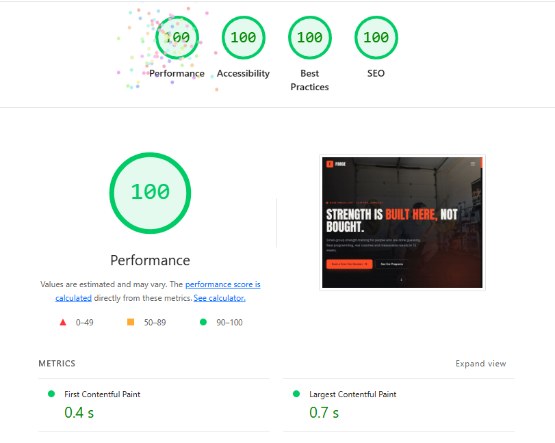

# FORGE Strength Studio 💪

**A responsive business landing page for a modern strength-training studio.**

[](https://forge-strength-studio.netlify.app/) [](https://github.com/anamkhan2007/tsg-webdev-p02-anamkhan)

## 🌐 Project Links

- **Live Website:** https://forge-strength-studio.netlify.app/
- **GitHub Repository:** https://github.com/anamkhan2007/tsg-webdev-p02-anamkhan

## 📸 Website Preview

### Desktop Homepage



## 🚀 Lighthouse Audit

The live website was audited with **Google Lighthouse 13.4.1** in Chrome DevTools using **desktop emulation** on **October 13, 2026, at 3:06 AM (GMT+5)**.

| Lighthouse Category | Score |
|---|---:|
| Performance | **100/100** |
| Accessibility | **100/100** |
| Best Practices | **100/100** |
| SEO | **100/100** |

### Key Performance Metrics

| Metric | Result |
|---|---:|
| First Contentful Paint (FCP) | 0.4 s |
| Largest Contentful Paint (LCP) | 0.7 s |
| Total Blocking Time (TBT) | 40 ms |
| Cumulative Layout Shift (CLS) | 0 |
| Speed Index | 0.8 s |

### Lighthouse Report Screenshot



> Lighthouse scores are estimates and can vary between runs, devices, and network conditions. Accessibility and SEO also include checks that require manual review; a perfect automated score does not replace manual testing.

## ✨ Features

- Responsive landing page for a strength-training studio
- Multi-section business-focused layout
- Navigation and interactive UI elements
- Mobile-friendly layout and navigation
- Performance-focused styling and locally included font files

## 🛠️ Built With

- HTML5
- CSS3
- JavaScript
- Tailwind CSS
- Google Chrome DevTools / Lighthouse
- Netlify for deployment

## 📁 Project Structure

```text
.
├── README.md
├── screenshots/
│   ├── homepage-desktop.png
│   └── lighthouse-report.png
└── forge-landing/
    ├── index.html
    ├── css/
    │   └── styles.css
    ├── js/
    │   └── script.js
    ├── fonts/
    ├── src/
    │   └── input.css
    ├── package.json
    └── tailwind.config.js
```

## 💻 Run Locally

1. Clone the repository:

   ```bash
   git clone https://github.com/anamkhan2007/tsg-webdev-p02-anamkhan.git
   ```

2. Open the `forge-landing` directory.
3. Open `index.html` in your browser, or use a local development server such as the VS Code Live Server extension.

To rebuild the Tailwind CSS, install the project dependencies in `forge-landing` and run the build script defined in `package.json`:

```bash
npm install
npm run build
```

## 📱 Responsive Testing

Test the site at desktop, tablet, and mobile viewport sizes. Recommended widths for screenshots are 1440 px, 768 px, and 375 px. Add any additional screenshots to the `screenshots/` directory and update this README with their relative paths.

## 📋 Project Details

- **Project:** The Sky Gen — Web Development Project 02
- **Business Concept:** FORGE Strength Studio
- **Project Type:** Responsive Business Landing Page
- **Deployment:** Netlify

---

Made for **FORGE Strength Studio** as part of The Sky Gen Web Development Project 02.
